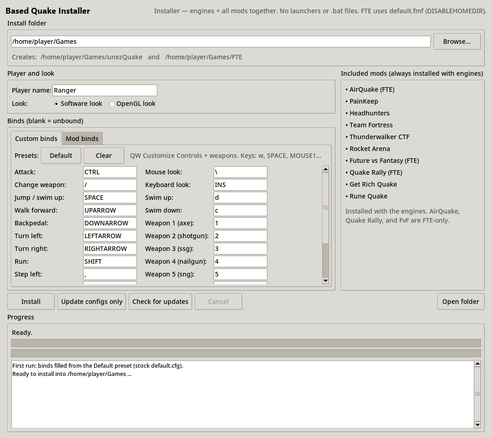
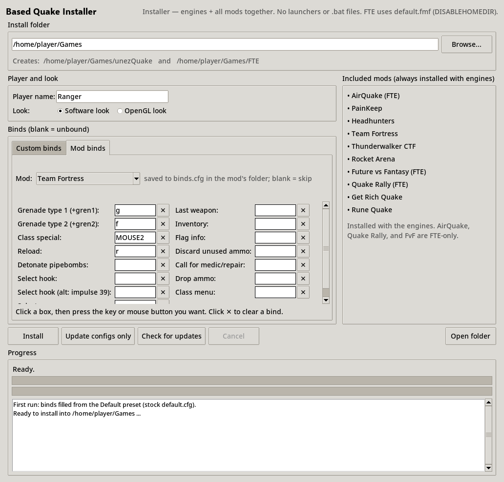
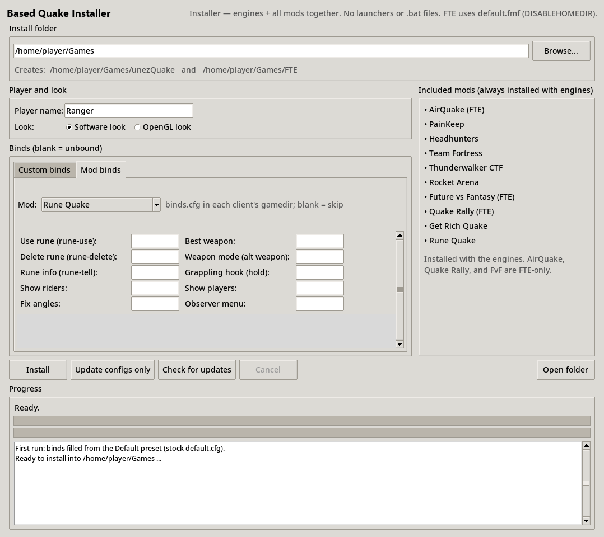
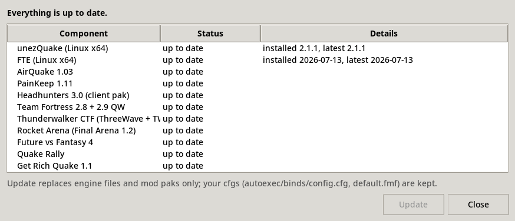

<div class="titlepage">
<div class="tp-kicker">User Manual</div>
<h1 class="tp-title">Based Quake Installer</h1>
<div class="tp-version">Version 1.6.6</div>
<div class="tp-sub">Set up unezQuake and FTE, the Quake shareware data, and ten classic mods in one go, with your name, look and key binds already written.</div>

<div class="tp-foot">Written for Quake and QuakeWorld players · Windows · Linux<br>Installer by USDQC · Manual date: October 2026</div>
</div>

<div class="toc-page">
<h1 class="toc-heading">Contents</h1>
<!--TOC-->
</div>

# 1. What is Based Quake Installer?

Based Quake Installer is a small program with a simple window that gets you from "nothing" to "ready to frag" without hunting through old FTP sites. In one click it:

- downloads **unezQuake** (a QuakeWorld client based on ezQuake) and installs it in its own folder,
- downloads **FTE** (the newest official build from <https://www.fteqw.org/>) and installs it in a **separate** folder,
- gets the official Quake **shareware** data (`id1/pak0.pak`), checks it, and puts a copy into **both** clients,
- writes a config file for each client with your **player name**, your **look** (software-style or smooth OpenGL) and your **key binds**, and makes every mod folder use it too,
- installs **all of the included mods** automatically from the USDQC Google Drive (Team Fortress, CTF, Rocket Arena and more, listed in Chapter 4), checking each download's **sha256** fingerprint,
- sets up unezQuake's **server browser** with a list of live master servers (`sb/sources.txt`), and
- can later **check for updates** and replace only what has changed.

It's an installer and nothing more. It does **not** launch the games, it does **not** create `.bat` files or desktop shortcuts, and it does **not** use Slipgate or any other launcher. You start the games yourself (Chapter 6 shows how).

<div class="note"><b>FTE runs "no-home" out of the box.</b> Normally you'd start FTE with <code>-nohome</code> so it keeps its files in its own folder instead of your user profile. The installer gets the same result another way: it puts <code>DISABLEHOMEDIR 1</code> (written as <code>disablehomedir 1</code>) into FTE's <code>default.fmf</code> file. You can just double-click the FTE program in its folder.</div>

## 1.1 What you end up with

With the default folder on Windows, you get this:

```
C:\Games\
  based-quake-manifest.json      what was installed (used by "Check for updates")
  unezQuake\
    unezquake.exe                (Linux: unezQuake-x86_64.AppImage)
    autoexec.cfg                 exec based.cfg
    ezquake\sb\sources.txt       server browser sources
    id1\pak0.pak                 shareware data
    id1\based.cfg                your name, binds and look
    id1\autoexec.cfg             exec based.cfg (the file the game runs)
    painkeep\  hh\  fortress\  ctf\  arena\  grq\  runequake\
                                 each: autoexec.cfg (exec based.cfg ... exec binds.cfg) + binds.cfg
  FTE\
    fteqw64.exe                  (Linux: fteqw64)
    default.fmf                  contains disablehomedir 1
    autoexec.cfg
    id1\pak0.pak
    id1\based.cfg
    id1\autoexec.cfg
    airquake\  painkeep\  hh\  fortress\  ctf\  arena\  fvf\  rally\  grq\  runequake\
```

The two client folders are independent. Nothing is shared between them, so you can tweak, break or delete one without touching the other.

## 1.2 What it needs from you

- An internet connection. unezQuake comes from GitHub, FTE from fteqw.org, the shareware data from public id Software mirrors, and the mods from the USDQC Google Drive.
- About a couple of hundred megabytes of disk space for both clients and all mods.
- **Optional:** your own copy of **registered Quake** (`pak1.pak`) for the mods that need the full game. See Chapter 5.

# 2. Getting it running

On Windows the installer is a single program file with everything built in, so **you don't need Python or anything else**. On Linux it's a small Python program (tkinter) that the `.deb` sets up for you. Either way it always downloads the unezQuake and FTE builds for the system it's running on. Get the files from the **Releases** page: <https://github.com/USDQC/based-quake-installer/releases>.

## 2.1 Windows 10 / 11

1. Download **`BasedQuakeInstaller-windows-x64.zip`** from the latest release.
2. Unzip it anywhere you like (right-click → **Extract All…**). Inside are `BasedQuakeInstaller.exe`, the README, the licence and the 7-Zip licence note.
3. **Double-click `BasedQuakeInstaller.exe`.** That's it: no Python, no setup.

<div class="note"><b>"Windows protected your PC"?</b> The exe isn't code-signed, so Microsoft Defender SmartScreen may show this the first time. Click <b>More info</b>, then <b>Run anyway</b>. The program is built from the public source by GitHub Actions; each release lists the build run.</div>

The program can live anywhere, even in `C:\Program Files`: it never writes next to itself. Your settings go to `%APPDATA%\BasedQuakeInstaller\settings.json`, and the games go wherever you choose (default `C:\Games`). You don't need administrator rights unless you install the *games* into a protected folder.

The exe takes a few seconds to open, because it unpacks itself to a temporary folder first. If your antivirus is suspicious of it, you can run the same program from source instead: download **`based-quake-installer-source-windows.zip`**, install 64-bit Python 3.8+ from <https://www.python.org/downloads/windows/> (keep **"tcl/tk and IDLE"** ticked), unzip, and double-click `run_installer.bat`. `build_exe.bat` in that zip builds the same exe yourself (it uses PyInstaller): `dist\BasedQuakeInstaller.exe`, plus `dist\BasedQuakeInstaller-cli.exe` for the command line (Chapter 9).

## 2.2 Linux: Debian, Ubuntu, Pop!_OS, Mint

The easy way is the `.deb` package. Open a terminal in the folder where you downloaded it and run:

```
sudo apt install ./based-quake-installer_1.6.6_all.deb
```

This pulls in `python3` and `python3-tk` automatically and adds a **Based Quake Installer** entry to your applications menu. You can also start it from a terminal with `based-quake-installer`. The program itself lives in `/opt/based-quake-installer`.

**No .deb?** Use the tarball instead:

```
tar xzf based-quake-installer-linux.tar.gz
./based-quake-installer/run_installer.sh
```

(You'll need Python 3 with tkinter. On Debian-family systems that's `sudo apt install python3-tk`.)

## 2.3 Default install folder

| System | Default install folder |
|---|---|
| Windows | `C:\Games` |
| Linux | `~/Games` (the `Games` folder in your home folder) |

You can change it in the window before you click Install.

# 3. A tour of the window


The window is laid out from top to bottom in the order you'll use it: where to install, who you are and how it should look, your keys, and then the buttons and progress area. On the right, a panel lists the mods that come along.

## 3.1 Install folder

The text box at the top holds your **install root**. Type a full path, or click **Browse...** to pick a folder. The grey line underneath shows the two folders that will be created, for example:

`Creates: C:\Games\unezQuake and C:\Games\FTE`

A full path is required: on Windows something like `C:\Games` or `D:\Games` (network paths starting with `\\` work too). On Linux an absolute path like `/home/you/Games` or `~/Games` is fine.

## 3.2 Player and look

**Player name.** This is the name other players see. A few rules:

- Up to **31 characters** (the box won't let you type more).
- Quake config files can't hold a double quote inside a name, so any `"` is written as `'`. The log tells you when this happens.
- The name can't be left empty for Install or Update configs only (Check for updates doesn't need it).

**Look.** Choose how the game should look. Each client gets its own matching settings:

| Choice | What it does |
|---|---|
| **Software look** (default) | The original 1996 feel: sharp, chunky pixels (no texture smoothing) and classic square particles. In FTE it also turns on software-style colour banding and the old "wobbly" model texturing. In unezQuake it also keeps the gun, HUD, text and crosshair unsmoothed and draws the HUD at an even 2× scale, so every pixel stays square. |
| **OpenGL look** | Smooth, filtered textures. FTE uses its modern scripted particles; unezQuake turns on flash-blended lights and 8× anisotropic filtering. |

Both choices also set a few sensible basics in each client: screen size 100, gamma 1.0, volume 0.7, mouse sensitivity 3, and mouse look switched on. unezQuake also gets the classic small cross crosshair (<code>crosshair 1</code>); FTE keeps its own. The exact setting names differ between clients (for example unezQuake uses <code>freelook</code> and <code>gl_anisotropy</code>; FTE uses <code>mlook_enabled</code> and its own particle settings), so each client's <code>based.cfg</code> gets the names that engine understands.

**Which builds you get.** There's no platform choice: the installer always installs the builds for the system it runs on.

| System | unezQuake | FTE |
|---|---|---|
| Windows x64 | `unezquake.exe` | `fteqw64.exe` (official fteqw.org build) |
| Linux x64 | `unezQuake-x86_64.AppImage` | `fteqw64` (official fteqw.org build) |

## 3.3 Binds: the Custom binds tab

The **Binds** box has two tabs. **Custom binds** holds your everyday keys for both clients. The list matches the classic QuakeWorld **Customize Controls** menu, plus the weapon slots:

| Movement and actions | (continued) | Weapons |
|---|---|---|
| Attack | Step right | Weapon 1 (axe) |
| Change weapon | Sidestep | Weapon 2 (shotgun) |
| Jump / swim up | Look up | Weapon 3 (ssg) |
| Walk forward | Look down | Weapon 4 (nailgun) |
| Backpedal | Center view | Weapon 5 (sng) |
| Turn left | Mouse look | Weapon 6 (grenade) |
| Turn right | Keyboard look | Weapon 7 (rocket) |
| Run | Swim up | Weapon 8 (shaft) |
| Step left | Swim down | Weapon 0 |
| | Show scoreboard | |

**How it works:**

- **Click a box, then press the key or mouse button you want.** The box turns yellow and says *Press a key…* while it waits; the key you press (or the mouse button you click, or a turn of the mouse wheel) fills it in with the name Quake uses, such as `w`, `SPACE` or `MOUSE2`.
- **Esc** cancels and keeps what was there. (Esc itself can't be bound here; it always opens the Quake menu.)
- You can't type into the boxes, so a bad key name can't get in.
- The small **✕** next to each box clears just that bind. **A blank box means "unbound".** Nothing is written for it.
- **Default** fills every box with the stock Quake keys from the original `default.cfg` (Ctrl to attack, arrow keys to move, Space to jump, Tab for the scoreboard, 1–8 for weapons, and so on).
- **Clear** empties every box, on **both** the Custom binds tab and the Mod binds tab.
- If you put the same key on two actions, the one lower in the list wins.

<div class="note"><b>Your settings are remembered.</b> The first time you open the installer, the boxes are filled with the <b>Default</b> preset. After each Install or Update configs only, your name, look, install folder, Custom binds and Mod binds are saved and loaded again next time (Windows: <code>%APPDATA%\BasedQuakeInstaller\settings.json</code>; Linux: <code>~/.config/based-quake-installer/settings.json</code>). If you click Install with <b>every</b> box empty, the installer asks before writing a config with no binds.</div>

A few handy keys are always added for you, unless you've used that key for something else: **Pause** = pause, **Esc** = menu, **~** and **\`** = console, **+**/**=** = bigger screen, **-** = smaller screen, **F12** = screenshot, **\\** = mouse look.

**Key names.** The boxes show the names unezQuake and FTE use in their configs. Shifted keys count as the plain key (Shift+; is still `SEMICOLON`), and the left and right Shift, Ctrl and Alt keys both give `SHIFT`, `CTRL` and `ALT`.

| The box shows | When you press |
|---|---|
| `a` … `z`, `0` … `9` | letter and number keys (e.g. `w`, `e`, `1`) |
| `,` `.` `/` `\` `[` `]` `'` `` ` `` `~` `-` `=` `+` | punctuation keys |
| `SEMICOLON` | the ; key (a bare `;` would end the bind command) |
| `SPACE` `TAB` `ENTER` `BACKSPACE` `PAUSE` `CAPSLOCK` | the usual named keys |
| `SHIFT` `CTRL` `ALT` | modifier keys |
| `UPARROW` `DOWNARROW` `LEFTARROW` `RIGHTARROW` | arrow keys |
| `INS` `DEL` `HOME` `END` `PGUP` `PGDN` | the editing block |
| `F1` … `F12` | function keys |
| `MOUSE1` `MOUSE2` `MOUSE3` `MOUSE4` `MOUSE5` | mouse buttons (1 = left, 2 = right, 3 = middle) |
| `MWHEELUP` `MWHEELDOWN` | mouse wheel |
| `KP_HOME` `KP_UPARROW` `KP_5` `KP_ENTER` `KP_PLUS` `KP_STAR` … | numeric keypad keys (the same with Num Lock on or off) |

A key that Quake has no name for (for example the Windows key, or a letter that only exists on a non-US keyboard) is ignored; the box keeps waiting, so press another key or Esc.

## 3.4 Binds: the Mod binds tab



Many mods add their own commands, such as throwing grenades in Team Fortress or firing the grappling hook in CTF. The **Mod binds** tab has a **Mod:** drop-down at the top to pick the mod, and a scrollable page of boxes for it: Team Fortress, Thunderwalker CTF, Rocket Arena, PainKeep, AirQuake (FTE), Quake Rally (FTE), Get Rich Quake and Rune Quake. The full list of what each mod offers is in Chapter 4.

- Click a box and press a key, the same way as on the Custom binds tab; **✕** clears one box. Fill in only the ones you want. **Blank = skip.**
- Your choices are saved into that mod's own folder as **`binds.cfg`**, in every client that has the mod (a mod with nothing filled in gets an empty `binds.cfg`).
- Every mod folder's `autoexec.cfg` runs `exec based.cfg` first (your name, Custom binds and look from `id1`), then the mod's own autoexec lines, then `exec binds.cfg`. So Mod binds are **added on top of** your Custom binds, and a mod's own settings still apply.
- Mod binds also load when a server switches you into the mod (for example, joining a Thunderwalker server from the base game). For that, FTE mod folders that don't ship their own `quake.rc` or `default.cfg` get a small `quake.rc`, and unezQuake mod folders get a `frontend.cfg`. Going back to a base server puts your normal binds back.
- If a mod bind uses a key that a Custom bind already uses (say Tab for Team Fortress *Inventory*), both are kept: the mod bind wins inside that mod only, and the log notes it. Everywhere else the key keeps its Custom bind.
- If a page has more boxes than fit, scroll it (scroll bar or mouse wheel).

Headhunters and Future vs Fantasy don't have tabs: Headhunters' docs don't list any bindable commands, and Future vs Fantasy's readme literally says "No Impulses to Bind". Your normal weapon keys cover them.



## 3.5 Included mods panel

The panel on the right just shows the mods that will be installed. There are no tick boxes: **every mod is always installed** with the engines. Mods marked **(FTE)** go into the FTE folder only. All the others go into both clients.

## 3.6 The buttons

| Button | What it does |
|---|---|
| **Install** | The full job: downloads both clients, the shareware data and all mods, then writes all config files and FTE's `default.fmf`. It's safe to run again on an existing install. |
| **Update configs only** | Downloads nothing. It rewrites `id1/based.cfg` and the `autoexec.cfg` files (name, look, binds), every mod folder's `autoexec.cfg` and `binds.cfg`, and checks `default.fmf`. Use it after changing your keys or name. You need a finished install first. |
| **Check for updates** | Looks online for newer client builds or changed mods (via `mods.json` on Google Drive) and shows a list. From that list, **Update** downloads only what changed. See Chapter 7. |
| **Update installer** | Checks for a newer version of this installer program and offers to update it. Games, mods and configs aren't touched. See 7.1. |
| **Cancel** | Stops a running install or update. It's only active while something is running. |
| **Open folder** | Opens your install folder in Explorer or your file manager. |

While a job is running, the other controls are greyed out. If you close the window mid-install, the installer asks whether to cancel and quit.

## 3.7 Progress and log

At the bottom you'll find:

- a **status line**, for example *"Step 6 of 7: 4.0 MB / 9.4 MB"*,
- a **file bar** showing the current download, and a **total bar** showing the whole job,
- the **log**, which records everything: every URL tried, every file written, and every warning. Lines are coloured **green** for OK, **amber** for warnings and **red** for errors.

A full install runs these seven steps:

1. Download unezQuake for this system
2. Download FTE for this system
3. Get the Quake shareware `pak0.pak`. It's checked against its known size and MD5 fingerprint. If a good copy is already installed, the download is skipped.
4. Copy `pak0.pak` into both `id1` folders
5. Install all the mods (download each zip from Google Drive, check its sha256, unzip it into each client)
6. Write the configs: `id1/based.cfg` and `autoexec.cfg` for each client, then each mod folder's `autoexec.cfg` and `binds.cfg` (after the mods, so a mod's own autoexec is kept)
7. Configure FTE (`default.fmf` with disablehomedir) and save the install manifest

At the end the log shows **INSTALL COMPLETE**, where each program is, which mods went where, and any that couldn't be installed.

## 3.8 Your first install in 60 seconds

1. Check the install folder (the default is fine).
2. Type your **player name**.
3. Pick **Software look** or **OpenGL look**.
4. Check the Custom binds (they start as the Default preset), then click any box and press the key you want instead (e.g. `w`/`s`/`a`/`d` and `MOUSE1`).
5. Optionally fill in a few **Mod binds** (e.g. Team Fortress grenades).
6. Click **Install** and wait for **INSTALL COMPLETE**.
7. Optionally copy your `pak1.pak` in (Chapter 5), then play (Chapter 6).

# 4. The mods

Every mod below is installed automatically. Each one lives in its own **game folder** (gamedir), which is the name you pass to `-game` when you play it.

| Mod | Game folder (`-game`) | Clients | Needs registered Quake? | Drive file (built from) |
|---|---|---|---|---|
| AirQuake 1.03 | `airquake` | **FTE only** | No | `airquake.zip` (`airq102.zip` + `airq103p.zip` patch) |
| PainKeep 1.11 | `painkeep` | both | Yes | `painkeep.zip` (`PK111NWN.ZIP`) |
| Headhunters 3.0 (client pak) | `hh` | both | Yes | `hh.zip` (`hh30cl.zip`) |
| Team Fortress 2.8 + 2.9 QW | `fortress` | both | Yes | `fortress.zip` (`tf28.zip` with `tf29qw.zip` on top) |
| Thunderwalker CTF (ThreeWave + TW 3.01) | `ctf` | both | Yes | `ctf.zip` (`3wctfc.zip` + `tw301_cl.zip`) |
| Rocket Arena (Final Arena 1.2) | `arena` | both | No | `arena.zip` (`farena12.zip`) |
| Future vs Fantasy 4 | `fvf` | **FTE only** | Yes | `fvf.zip` (`fvf4.zip` + client pak 2.09.21) |
| Quake Rally 1.2 + Leftovers | `rally` | **FTE only** | Yes | `rally.zip` (`qr12.zip` + `qrlo1.zip`) |
| Get Rich Quake 1.1 | `grq` | both | Yes | `grq.zip` (`grqcl_11.zip` + `grqsv11a.zip`) |
| Rune Quake | `runequake` | both | No | *nothing* (server-side mod) |

"Both" means unezQuake **and** FTE. "Needs registered Quake" means the mod uses maps or content from the full game. It'll work best (or at all) once your `pak1.pak` is in place (Chapter 5).

<div class="note"><b>Rune Quake is a server-side mod.</b> All the game logic runs on the server, so there's nothing to download. The installer just creates a <code>runequake</code> folder in each client with a <code>binds.cfg</code> and an <code>autoexec.cfg</code> that runs it, so your Rune Quake keys are ready when you join a Rune Quake server.</div>

<div class="note"><b>Skin and spray packs.</b> The skin pack goes into <code>qw/skins</code> in both clients; the spray pack goes into <code>qw/sprays</code> in unezQuake only (FTE has no sprays). They only add or replace the pack's own files, so your own skins stay. To spray, set a key in the <b>Spray (unezQuake only)</b> row of Custom binds (blank by default; it is written only to unezQuake). Hold to aim, let go to place; <code>based.cfg</code> sets <code>cl_spray_image usdqc</code>. Sprays only show on servers that support them, and unezQuake looks for the image in the current game folder, so they work in base QuakeWorld (<code>qw</code>) but not inside mods.</div>

**Where the files come from.** Every mod comes **only from the USDQC Google Drive**, as one ready-made zip per mod (`<game folder>.zip`). The zips were built from the original releases listed above: patches already applied, multi-part mods merged, nested archives unpacked and every file name lowercase, so no 7-Zip or other tools are needed. A small index file, `mods.json`, also on Drive, lists each zip's link, version, size and **sha256** fingerprint.

For each mod the installer downloads the zip (it handles Drive's "can't scan this file for viruses" confirmation page by itself), checks the size and sha256, and only then unzips it into the mod's folder in each client. **If the fingerprint doesn't match, nothing is installed** and the log says so (see Chapter 8). The mod's own config files are kept; your `autoexec.cfg` and `binds.cfg` are written afterwards (Chapter 6.3).

<div class="note"><b>Lowercase file names.</b> Old DOS archives shipped names like <code>PAK0.PAK</code> and <code>GFX/</code>, and unezQuake on Linux needs them lowercase. The Drive zips are already lowercase. On Linux the installer also lowercases any uppercase names an older version left behind. Windows doesn't care about case.</div>

## 4.1 Mod binds, mod by mod

These are the actions offered on each **Mod binds** tab. All of them come from the mods' own readmes, config files or source code; nothing is made up.

**Team Fortress** (`fortress`)

| Action | Quake command |
|---|---|
| Grenade type 1 | `+gren1` |
| Grenade type 2 | `+gren2` |
| Class special | `special` |
| Reload | `reload` |
| Detonate pipebombs | `detpipe` |
| Select hook | `impulse 22` |
| Select hook (alt: impulse 39) | `impulse 39` |
| Select axe | `impulse 40` |
| Last weapon | `impulse 69` |
| Inventory | `inv` |
| Flag info | `flaginfo` |
| Discard unused ammo | `discard` |
| Call for medic/repair | `saveme` |
| Drop ammo | `dropammo` |
| Class menu | `changeclass` |

**Thunderwalker CTF** (`ctf`)

| Action | Quake command |
|---|---|
| Quick AirFist (fire, switch back) | `+bqi_airfist` = `impulse 47; +attack`, release `-attack; impulse 69` |
| Quick grappling hook (hold, switch back) | `+bqi_hook` = `impulse 22; +attack`, release `-attack; impulse 69` |
| Grappling hook | `impulse 22` |
| Throw ammo backpack | `impulse 20` |
| Throw current weapon | `impulse 21` |
| Flag status | `impulse 23` |
| AirFist | `impulse 47` |
| Previous weapon | `impulse 69` |
| Fire flare | `impulse 160` |
| Rune info | `impulse 180` |
| Destroy/drop rune | `impulse 181` |
| Personal teleporter | `impulse 200` |
| ID target | `impulse 141` |

**Rocket Arena** (`arena`)

| Action | Quake command |
|---|---|
| Arena stats | `impulse 68` |
| Line position | `impulse 69` |
| Take break / return | `impulse 70` |
| Status bar 320x200 | `impulse 71` |
| Status bar 320x240+ | `impulse 72` |

**PainKeep** (`painkeep`). Keys 1–8 still pick weapons as normal; these are optional direct selects.

| Action | Quake command |
|---|---|
| Quick AirFist (fire, switch back) | `+bqi_airfist` = `impulse 30; +attack`, release `-attack; impulse 69` |
| Quick Gravity Well (drop, back) | `+bqi_gravitywell` = `impulse 33; +attack`, release `-attack; impulse 69` |
| Quick bear trap (drop, back) | `+bqi_beartrap` = `impulse 34; …` (same pattern) |
| Quick AutoSentry (drop, back) | `+bqi_autosentry` = `impulse 35; …` (same pattern) |
| Quick Pork & Beans (use, back) | `+bqi_beans` = `impulse 36; …` (same pattern) |
| Grapple / harpoon | `impulse 21` |
| AirFist | `impulse 30` |
| Chain lightning | `impulse 32` |
| Gravity Well | `impulse 33` |
| Bear trap | `impulse 34` |
| AutoSentry | `impulse 35` |
| Pork & Beans | `impulse 36` |
| Inventory stats | `impulse 38` |
| Release harpoon | `impulse 50` |
| Previous weapon | `impulse 69` |

**Quick rows.** Hold the key: the item is selected and fires. Let go: you're back on the weapon you had, using the mod's own previous-weapon impulse (69). The alias lines are written to `binds.cfg` only for rows you fill in. Notes:

- If you don't have the item (PainKeep AirFist and items are pickups outside deathmatch 4/5; a Thunderwalker server can turn the hook off), the key fires your current weapon and release switches to your previous one.
- PainKeep items: tap the key. Holding it keeps dropping one every half second. Using your **last** one makes PainKeep switch to your best weapon, and you stay there.

**AirQuake** (`airquake`, FTE only)

| Action | Quake command |
|---|---|
| Free look | `+freelook` |
| Extra left / roll | `+extraleft` |
| Extra right / roll | `+extraright` |
| Cockpit zoom in | `+cczoomin` |
| Cockpit zoom out | `+cczoomout` |
| Lift camera | `liftcam` |
| Lock turret | `lockturret` |
| Weapon / slot 9 | `impulse 9` |

**Quake Rally** (`rally`, FTE only)

| Action | Quake command |
|---|---|
| Accelerate | `+accelerate` |
| Reverse | `+reverse` |
| Horn | `+horn` |
| Camera zoom in | `+zoomin` |
| Camera zoom out | `+zoomout` |
| Camera near/far | `impulse 40` |
| In-car view toggle | `impulse 43` |
| Headlights | `impulse 50` |
| Observer next | `impulse 150` |
| Observer prev | `impulse 151` |
| Change car | `impulse 201` |
| Camera sway loose | `impulse 120` |
| Camera sway tight | `impulse 130` |

**Get Rich Quake** (`grq`)

| Action | Quake command |
|---|---|
| Cashbox (drop/fill/status) | `impulse 120` |
| Grappling hook | `impulse 22` |
| Team scores | `impulse 121` |

**Rune Quake** (`runequake`)

| Action | Quake command |
|---|---|
| Use rune (rune-use) | `impulse 100` |
| Delete rune (rune-delete) | `impulse 98` |
| Rune info (rune-tell) | `impulse 99` |
| Show riders | `impulse 96` |
| Fix angles | `impulse 95` |
| Best weapon | `impulse 92` |
| Weapon mode (alt weapon) | `impulse 86` |
| Grappling hook (hold) | `+hook` |
| Show players | `impulse 97` |
| Observer menu | `impulse 201` |

**Headhunters** (`hh`) and **Future vs Fantasy** (`fvf`) have no extra binds. Your normal Custom binds are all you need.

# 5. Adding registered Quake (pak1.pak)

The installer only installs the free **shareware** episode (`pak0.pak`). It never downloads or ships the registered game. Several mods use the full game's maps and content, though: PainKeep, Headhunters, Team Fortress, Thunderwalker CTF, Future vs Fantasy, Quake Rally and Get Rich Quake. To get the most out of them, add **your own** legal copy of `pak1.pak`.

**Where to find it.** In your own Quake installation (CD, Steam, GOG, etc.), look in the `id1` folder for `pak1.pak`. (Steam's and GOG's "Quake" folders contain an `id1` folder with `pak0.pak` and `pak1.pak`.)

**Where to put it.** Copy `pak1.pak` into the `id1` folder of **each client** that has the mods you want to play:

| You want to play… | Copy pak1.pak to |
|---|---|
| any mod in **both** clients (PainKeep, Headhunters, TF, CTF, GRQ) | `unezQuake\id1\` **and** `FTE\id1\` |
| FTE-only mods (Future vs Fantasy, Quake Rally) | `FTE\id1\` |

With the default Windows folder that's `C:\Games\unezQuake\id1\pak1.pak` and `C:\Games\FTE\id1\pak1.pak`. You only need `pak1.pak`. Leave the installer's `pak0.pak` where it is (the original registered game's `pak0.pak` is the same file as the shareware one).

You can add `pak1.pak` before or after installing. Re-running the installer won't remove it, and **Check for updates** never touches it.

# 6. Playing

## 6.1 Starting the clients

The installer doesn't make shortcuts or launchers, so you start the games from their folders:

| | unezQuake | FTE |
|---|---|---|
| **Windows** | double-click `C:\Games\unezQuake\unezquake.exe` | double-click `C:\Games\FTE\fteqw64.exe` |
| **Linux** | in `~/Games/unezQuake`, run `./unezQuake-x86_64.AppImage` | in `~/Games/FTE`, run `./fteqw64` |

FTE needs no extra options. Its `default.fmf` already switches off the "home folder", so it reads and saves everything inside `FTE\`. You never need to type `-nohome`.

## 6.2 Loading a mod with -game

To play a mod, start the client with **`-game <folder>`**, using the game-folder name from the table in Chapter 4. From a terminal or Command Prompt **inside the client's folder**:

```
unezquake.exe -game fortress           (Windows, unezQuake)
fteqw64.exe -game rally                (Windows, FTE)
./unezQuake-x86_64.AppImage -game ctf  (Linux, unezQuake)
./fteqw64 -game airquake               (Linux, FTE)
```

**Tip (Windows):** to make your own one-click shortcut, right-click the exe → **Create shortcut**, open the shortcut's **Properties**, add ` -game fortress` to the end of **Target**, and make sure **Start in** is the client's folder.

You can also switch mods from inside the game by typing `gamedir fortress` in the console (press **~**).

## 6.3 Where your settings go

| File | What's in it | Written by |
|---|---|---|
| `<client>\id1\based.cfg` | your name, binds, look and base settings | Install / Update configs only |
| `<client>\id1\autoexec.cfg` | `exec based.cfg`: the file the game runs | Install / Update configs only |
| `<client>\autoexec.cfg` | the same `exec based.cfg` line, next to the program | Install / Update configs only |
| `unezQuake\ezquake\autoexec.cfg` | same again, in unezQuake's own folder | Install / Update configs only |
| `unezQuake\ezquake\sb\sources.txt` | the server browser's list of master servers (6.4) | Install / Update / Update configs only (merged, never wiped) |
| `<client>\<gamedir>\autoexec.cfg` | `exec based.cfg`, then the mod's own autoexec lines (kept), then `exec binds.cfg` | Install / Update configs only |
| `<client>\<gamedir>\binds.cfg` | the Mod binds you filled in for that mod | Install / Update configs only |
| `FTE\<gamedir>\quake.rc` | runs `autoexec.cfg` when a server switches FTE into the mod (only for mods without their own `quake.rc` / `default.cfg`) | Install / Update configs only |
| `unezQuake\<gamedir>\frontend.cfg`, `unezQuake\qw\frontend.cfg` | runs `autoexec.cfg` when a server switches unezQuake into that folder | Install / Update configs only |
| `FTE\default.fmf` | FTE's startup manifest, including `disablehomedir 1` | Install (patched, never replaced if present) |

Because Quake looks in `id1` for any file a mod folder doesn't have, `exec based.cfg` inside a mod folder finds your `id1\based.cfg`, so your name, binds and look apply in every `-game`. A mod that ships its own `AUTOEXEC.CFG` (AirQuake does) keeps its lines; they're merged into one lowercase `autoexec.cfg`.

If one of these files already exists and is different, the installer first copies it to **`<name>.bak`**. You can edit the files by hand afterwards; just remember that **Install** and **Update configs only** rewrite `based.cfg` from whatever is in the window at the time.

## 6.4 The server browser (unezQuake)

unezQuake's server browser (main menu → **Servers**) needs a list of *sources*, the master servers that know which QuakeWorld servers are online. unezQuake itself doesn't ship one, so the browser would stay empty. The installer writes `unezQuake\ezquake\sb\sources.txt` with sources that were checked and found live (October 2026):

| Source | Address |
|---|---|
| QuakeServers.net | master `master.quakeservers.net:27000` |
| Asgaard | master `qwmaster.fodquake.net:27000` |
| QuakeWorld.nu | master `master.quakeworld.nu:27000` |
| QuakeServers URL | list `https://www.quakeservers.net/lists/servers/global.txt` |

Each line looks like `master "Name" host:port` (or `url "Name" address`); lines starting with `/` are comments. If you already have a `sources.txt`, your own entries are **kept**: the installer only removes exact duplicates and adds the sources that are missing. When the file changes, the old one is saved as `sources.txt.bak`. Old ezQuake defaults that no longer work (for example the "Poland" master `217.153.59.106`) are left alone if you have them, with a note in the log.

A source only counts when it is ticked, so the installer also adds `sb_sourcemark "…"` lines for its four sources to unezQuake's `id1\based.cfg`. They're re-ticked every time the game starts; to untick one for good, remove its line from `based.cfg`. FTE has its own built-in master servers and isn't changed.

# 7. Checking for updates



Click **Check for updates** on an existing install. The installer reads its record of what it installed (`based-quake-manifest.json` in your install folder) and compares it with what's online:

| Component | How it's checked |
|---|---|
| **unezQuake** | the latest release tag on GitHub (dusty-qw/unezquake). If the GitHub API can't be reached or is rate-limited, it falls back to the known 2.1.1 release. |
| **FTE** | the newest dated build linked from <https://www.fteqw.org/>; the version is the build date (e.g. 2026-07-13) |
| **Each mod** | `mods.json` on the USDQC Google Drive: each mod's **version** and **sha256** compared with what was installed |
| **Rune Quake** | not checked: nothing was downloaded for it |

A window lists each component with its status:

| Status | Meaning |
|---|---|
| up to date | nothing to do (normal for the mods; they only change when USDQC publishes a new zip) |
| update available | something newer or different is online |
| not installed | it's missing, so Update will install it |
| other platform | the install was made on the other system (e.g. a Windows install opened from Linux); its clients are skipped |
| no build for this platform | no build is published for this system; skipped |
| check failed | that server couldn't be reached; the details column says why |

If anything needs updating, the **Update N** button downloads and installs **only those components**. Otherwise the window says "Everything is up to date" and the button is greyed out.

**What an update keeps.** Program files and mod paks are overwritten, but your settings are never touched. Any existing `autoexec.cfg`, `binds.cfg`, `config.cfg`, `fte.cfg` and `default.fmf` are kept (the log says "kept your …"), and mod folders are never wiped, so your own extra maps and `pak1.pak` stay put.

<div class="note"><b>Upgrading from 1.6.2 or older: one-time mod re-download.</b> Older versions installed the mods from public mirrors and didn't record a sha256, so the first Check for updates after upgrading shows every mod as <b>update available</b>. Click <b>Update</b> once (about 74 MB) to swap them for the verified Drive zips. Your configs and extra files stay, as with any update.</div>

**Offline?** Nothing breaks. The check simply shows "check failed" rows, and nothing is changed.

**The manifest file.** `based-quake-manifest.json` is written by every Install and Update. It records the system it was installed for (`windows` or `linux`), plus, for each client and mod, the version, URL, size, sha256 (mods), ETag and date, and when it was installed. You don't need to edit it. If you delete it, the next Install recreates it.

<div class="note"><b>Updates stay on the same system.</b> If the manifest says the install was made on the other system, Check for updates tells you, marks the clients "other platform" and never installs this system's builds over them. Mods are the same on both systems and are still checked. To switch a folder to this system's clients, click <b>Install</b>.</div>

## 7.1 Updating the installer itself

**Update installer** checks GitHub for a newer release of Based Quake Installer. If there is one, it shows the version and what's new, with **Update now** and **Later**. Otherwise it says you have the latest version. It only updates the installer program; your games, mods and configs are not touched.

- **Windows exe:** downloads the new zip, checks its size and sha256, swaps in the new `BasedQuakeInstaller.exe` and restarts. The old exe is left as `BasedQuakeInstaller.exe.old` and deleted the next time the installer starts.
- **Linux .deb:** installs the new package with `pkexec apt-get install` (asks for your password). If that isn't possible, it shows the `sudo apt install` command to run.
- **Linux tarball:** replaces the program files in its folder and restarts.
- If the folder can't be written to (or for a git checkout), it opens the release page instead.

With **Check for a new installer when it starts** ticked (the default), the installer checks quietly on start and only shows a small notice next to the button. Nothing pops up if you're offline.

# 8. Troubleshooting and FAQ

**A mod says "NOT installed".** Read the log line under it. One missing mod never stops the rest of the install. The messages:

- **"sha256 mismatch … Nothing was installed."** The zip on Google Drive doesn't match the fingerprint in `mods.json`. Either the download was damaged (just try again) or the Drive file was replaced without `mods.json` being updated. That's for USDQC to fix; the installer won't install a file it can't verify.
- **"Google Drive returned 'Google Drive: Sign-in' … not shared as 'Anyone with the link'"**: the file isn't public on Drive (USDQC's side).
- **"… Drive download quota exceeded for this file; try again in 24h"**: Google limits how often one file can be downloaded per day. Wait and click **Install** or **Update** again.
- **"is N bytes, expected M (wrong or partial file)"**: the download was cut short. Try again.
- **"could not read mods.json from Drive … using built-in mod list"** (a warning): the index couldn't be fetched, so the installer used the links built into this version. Installs still work; Check for updates shows the mods as "check failed".

If you already downloaded a mod's Drive zip (for example `fortress.zip`), you can install that copy with `--mod-file` (Chapter 9). It's checked the same way.

**A mod complains about missing maps or content.**
It probably needs registered Quake. Add `pak1.pak` to that client's `id1` folder (Chapter 5).

**"Cannot overwrite … (is the game running?)"**
A file is locked, usually because unezQuake or FTE is still open (or an antivirus scanner is busy with it). Quit the game and click **Install** again.

**"No permission to create C:\Games" / "Folder is not writable".**
Pick a folder you own, such as `D:\Games` or a `Games` folder inside your user folder, or run the installer as administrator.

**SSL or network errors.**
A proxy or antivirus may be inspecting secure connections. The log shows the exact URL and error. The shareware data has three mirrors. Mod downloads from Google Drive are retried automatically.

**"pak0.pak checksum mismatch".**
A mirror served a damaged file. The installer refuses to use it. Try again later.

**The unezQuake AppImage won't start on Linux.**
Check it's executable (`chmod +x unezQuake-x86_64.AppImage`; the installer sets this for you). Some newer distributions also need the FUSE 2 library for AppImages (e.g. `sudo apt install libfuse2`, or `libfuse2t64` on Ubuntu 24.04).

**unezQuake says it can't find `gfx/conback.lmp` (or another file) inside a mod.**
That usually means the mod's files are still uppercase (`GFX/CONBACK.LMP`). Re-run **Install** (or `--mods-only`) with v1.6.2 or later so the installer lowercases them.

**Is it safe to run Install again?**
Yes. It re-downloads the clients and mods and copies them over the top. A valid `pak0.pak` is reused, your `pak1.pak` and other added files stay, and changed `autoexec.cfg` files are backed up to `.bak` first. Your last settings are loaded when the window opens, so you can just click Install.

**My binds or name don't apply inside a mod I installed by hand.**
Click **Update configs only**. It gives every mod folder an `autoexec.cfg` that runs `exec based.cfg` (and keeps the mod's own lines).

# 9. Command-line options

For scripting or headless use, `installer_cli.py` (or `BasedQuakeInstaller-cli.exe`, if you built it with `build_exe.bat`) does the same job without the window. `--version` prints the version and `--self-test` checks that the program and its bundled tools start. Run it from the installer folder, e.g. `python installer_cli.py --root "C:\Games" --name Ranger --preset vanilla --look gl`.

| Option | Meaning | Default |
|---|---|---|
| `--root PATH` | install folder | `C:\Games` or `~/Games` |
| `--name NAME` | player name | `player` |
| `--preset` none, vanilla, wasd, modern | fill binds: `vanilla` = stock Quake keys; `wasd` = stock + WASD movement and MOUSE1 attack; `modern` = `wasd` **plus** weapons on 1 q e c v x r f (it includes WASD); `none` = no binds | `vanilla` |
| `--movement` vanilla, wasd | older way to choose a preset (combine with `--weapons`) | – |
| `--weapons` vanilla, modern | older way to choose a preset (combine with `--movement`) | – |
| `--look` soft, gl | Software look or OpenGL look | `soft` |
| `--configs-only` | only rewrite the configs (`based.cfg`, `autoexec.cfg`, mod folders) and check FTE `default.fmf` in an existing install | off |
| `--mods LIST` | comma list of mod keys, or `all` | `all` |
| `--mods-only` | only (re)install mods into an existing install | off |
| `--mod-file KEY=PATH` | install a mod's Drive zip you already downloaded (e.g. `fortress=fortress.zip`); still sha256-checked; can be repeated | – |
| `--check-updates` | just check an existing install and print the status of each component | off |
| `--update` | check, then install only what's out of date | off |

**Mod keys** for `--mods` and `--mod-file`: `airquake`, `painkeep`, `hh`, `fortress`, `thunderwalker` (folder `ctf`), `arena`, `fvf`, `rally`, `grq`, `runequake`.

Examples:

```
python installer_cli.py --root "C:\Games" --name Ranger --preset wasd --look gl
python installer_cli.py --root "C:\Games" --mods-only
python installer_cli.py --root "C:\Games" --mods fortress,fvf --mods-only --mod-file fortress=%USERPROFILE%\Downloads\fortress.zip
python installer_cli.py --root ~/Games --check-updates
python installer_cli.py --root ~/Games --update
```

Notes:

- The default `--preset vanilla` writes the stock Quake keys. Use `--preset none` for a config with no binds of your own.
- The CLI always installs the client builds for the system it runs on.
- The command line has no option for Mod binds. Use the window for those.
- `--update` returns exit code 1 if any component failed to update.

<div class="endnote">Quake shareware © id Software. The installer downloads the official <code>quake106.zip</code> and extracts <code>pak0.pak</code> at install time; it doesn't ship any pak files. unezQuake, FTE and the mods are third-party works under their own licences. <code>tools\7za.exe</code> (Windows package) is 7-Zip 9.20 by Igor Pavlov, GNU LGPL. Based Quake Installer is free software by USDQC under the GNU General Public License v3 or later (SPDX: GPL-3.0-or-later); source: <a href="https://github.com/USDQC/based-quake-installer">github.com/USDQC/based-quake-installer</a>.</div>
